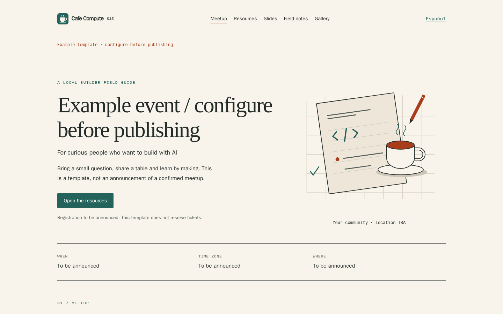

# Cafe Compute Kit

A website kit for community events, built from the Cafe Compute workflow and made reusable for other ambassadors.

**Event pages, workshop resources, slides, recaps, galleries, private feedback and one-benefit-per-person distribution. English and Spanish. MIT.**



This is an independent community project, not an official Cerebras product or an endorsement. Bring your own event details, permission-cleared media and approved benefit inventory. No actual attendee list, event photos, codes, credentials or production configuration is included.

## Pick your starting point

- **Just the website:** `apps/event-site`. Static pages with public JSON configuration. No database, email service or account needed to preview.
- **Website + private workflow:** build both workspaces and deploy the root Worker. It adds magic-link sign-in, guided feedback, stable private code/link assignments and an owner dashboard.
- **Feedback only:** deploy `apps/feedback` independently and point your existing event website at it.

One event per deployment and fresh database. This is not a multi-tenant ticketing platform, and it does not replace Luma registration/check-in.

## Quick start

Use Node **22.22.2** and the checked-in lockfile:

```sh
git clone https://github.com/arcacomputer/cafe-compute-kit.git
cd cafe-compute-kit
npm ci
npm run build
npm run preview
```

Open `http://127.0.0.1:4173/` or `/en/`. The localhost preview serves public pages only. Private sign-in/APIs intentionally return unavailable rather than pretending to authenticate anyone.

Copy `config/event.example.json` to your public event JSON and edit both languages:

```sh
npm run build -- --config config/my-event.json
```

Use `feedbackUrl: null` for a static-only event with no feedback backend. Otherwise use `/feedback/` for the combined deployment, or the HTTPS URL of your separately deployed feedback app. Public config must never contain attendee data, owners, secrets or benefit stock.

**Deployment is a separate, explicit step.** The samples have no account/domain binding, disable provider preview URLs, and keep sign-in, feedback, sends, claims and photos off. Follow the guide before changing gates.

## Guides

- [Getting started](docs/getting-started.md)
- [Free-tier setup: Cloudflare website or private workflow](docs/free-tier-setup.md)
- [Vercel Hobby: public static site only, eligibility and limits](docs/vercel-static-setup.md)
- [Deploy on Cloudflare + Neon](docs/deployment.md)
- [Guía de instalación y despliegue en español](docs/guia-es.md)
- [Luma import, inventory, review, export and retention](docs/operators.md)
- [Event preparation and recap checklist](docs/event-checklist.md)
- [Architecture](docs/architecture.md) · [Privacy/security](docs/security.md) · [Provenance](docs/provenance.md)

## Repository

```text
apps/event-site/   Public pages, resources, browser slides, recap/gallery templates
apps/feedback/     Worker, auth/forms/admin, SQL, imports/export and private sender
config/           Strictly public example event configuration
docs/             Deployment and operator guides in English/Spanish
scripts/          Combined build, localhost preview and verification helpers
```

The authenticated app uses Cloudflare Workers, PostgreSQL through Neon, an optional private R2 bucket and a separately deployed private mail sender. The public Worker never receives the broad mail-provider key. Provider integrations are replaceable; no framework migration is required to use the static site.

Feedback may be critical; `N/A` is accepted. Photo submission and promotional consent are optional, not benefit prerequisites. Login access, attendance and benefit eligibility are separate. Assigned codes remain assigned across retries/login; assignment does not prove redemption by the provider. Exports contain private free text/photos and require manual review before sharing.

Photos are disabled by default. If enabled, they are **private originals**, not guaranteed metadata-stripped or server-decoded images. Read the privacy/retention limitations before enabling them. No stock provider logos/fonts or third-party event photos are bundled.

## Verification boundary

The repository includes source/unit, real PostgreSQL concurrency/privilege and Chromium proof commands. Do not infer successful execution merely from their presence. Release execution evidence is recorded in [verification](docs/verification.md) when available.

```sh
npm run check:source
npm run build
npm run test:unit
# After installing PostgreSQL and Chromium prerequisites:
PROOF_TMPDIR=/var/lib/postgresql npm run proof --workspace @cafe-compute-kit/feedback
npm run test:worker
```

The last two commands use only disposable local PostgreSQL, synthetic recipients/non-redeemable values, a no-send outbox and an isolated object adapter. The full feedback proof requires the pinned runtime and explicit local prerequisites in [PROOF.md](apps/feedback/PROOF.md). Root CI uses a disposable PostgreSQL service and never receives production credentials.

Local/sandbox proof does **not** establish deployed Cloudflare bindings, Neon HTTP transport, R2 privacy, actual mail delivery, provider redemption or legal adequacy of an operator's consent policy. Those require separately authorized deployment-specific checks.

## Contributing and license

[MIT](LICENSE). See [contributing](CONTRIBUTING.md) and [security reporting](SECURITY.md).

Human steward: **Luis Felipe Abarca**, [Arca Computer](https://arca.computer) / [felirami.com](https://felirami.com). Implementation and verification are AI-assisted by Cad, with human direction and publication approval. Original private event operations remain private; this repository is a curated reusable extraction, not a production archive.
